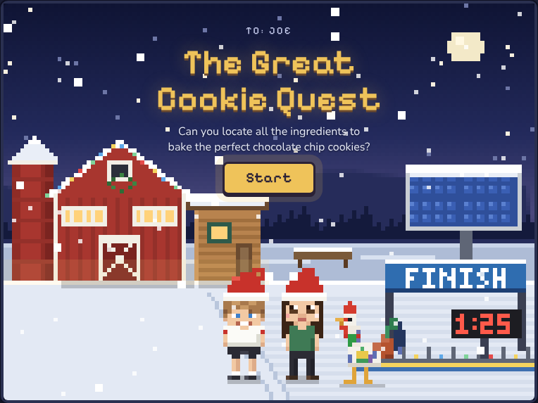
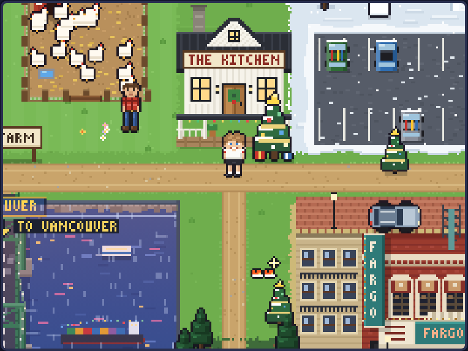
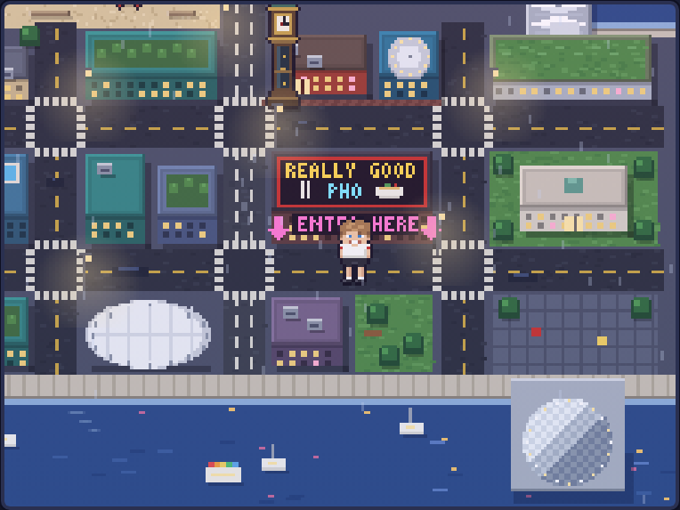
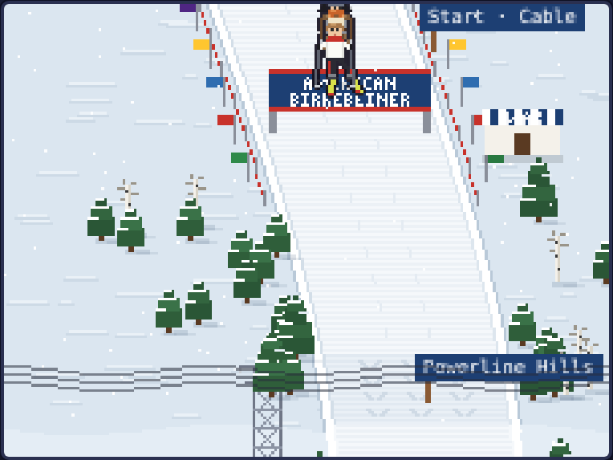
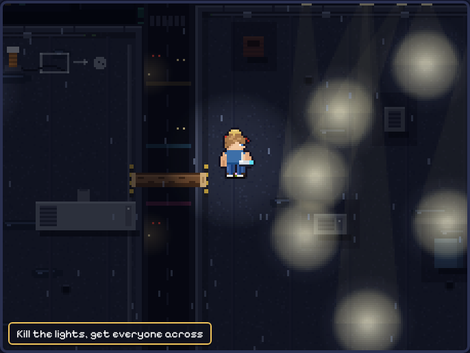
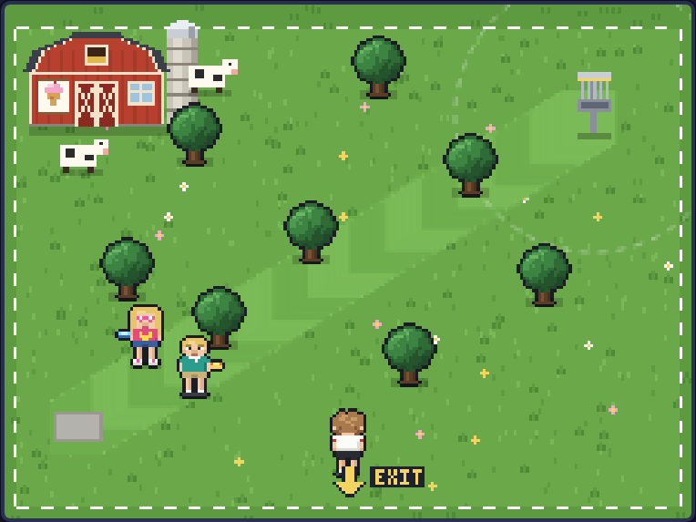
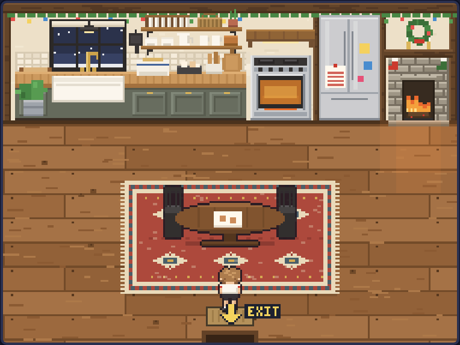

<div align="center">

# 🍪 The Great Cookie Quest

**A Christmas pixel game. Gather the ingredients, bake the cookies, wear the crown.**



</div>

Joe has five stops to make before he can bake: eggs and butter from the farm, flour from the Birkie, chocolate from the rooftops of Vancouver, sugar from Fargo, and milk from Wylee Woods. Then everyone comes over to the kitchen.

## Play

Open `index.html` in a browser. That's it: no install, no build, no internet needed.

Arrow keys (or the on-screen pad) to walk, **Space** or **A** to do things. **⛶ Full screen** under the game fills the whole display. It works on a phone too.

## The stops

| | |
|:---:|:---:|
| <br>**Home.** The kitchen, and the road to everywhere | <br>**Vancouver.** Over the bridge, through the park, find the pho |
| <br>**The Birkie.** Cable to Main Street, ahead of the Vikings | <br>**The heist.** Three rooftops, one very large chocolate |
| <br>**Wylee Woods.** Five holes against Jack and Margie | <br>**The kitchen.** Measure, crack, stir, bake |

## Changing the words

Every line anyone says is in **`js/story.js`**, grouped by place. Edit the text between the quotes, save, refresh.

## Before giving it to Joe

- [ ] Write the note at the end: `KITCHEN.note` in `js/story.js`
- [ ] Write the secret note (for finding every secret): `ENDING.secretNote` in `js/story.js`
- [ ] Open the game and press **Start over** twice (under the game), so it begins fresh

## Stuck?

Answers, secrets and shortcuts are in **[`cheats/`](cheats/README.md)**. Spoilers, obviously.

## For tinkering

<details>
<summary>What's in each file</summary>

| File | What it holds |
|---|---|
| `js/story.js` | All the words |
| `js/world.js` | The main map |
| `js/farm.js` | The hen chase, Keelan, Brian, the cupcake |
| `js/birkie.js` | The ski race |
| `js/vancouver.js` | The walk into Vancouver |
| `js/city.js`, `lasergrid.js`, `confectioner.js`, `anagrams.js`, `larsgames.js` | The heist |
| `js/fargo.js`, `scooter.js`, `lilqshop.js` | Fargo, the scooter race, the snack shop |
| `js/golf.js` | Disc golf |
| `js/kitchen.js` | Baking and the party |
| `js/people.js`, `jackc.js` | Jackie, Ethan, Maureen, Logan, Jack C |
| `js/ending.js` | Credits, stats, the photo album, the note |
| `js/extras.js` | Exits, hidden gear, Grp the rooster |
| `js/portraits.js`, `outline.js`, `title.js` | Faces, outlines, the title screen |
| `js/game.js`, `state.js`, `input.js`, `ui.js`, `sound.js` | The engine: movement, saving, controls, pop-ups, music |

Everything is drawn in code on a 224×168 canvas. There are no image or sound files.

</details>

<details>
<summary>Running the tests</summary>

Needs Node. Once: `npm install && npx playwright install chromium`. Then:

```
npm test
```

It checks every file for typos, then plays through every stop. The same tests run on GitHub after each push: a green check on the commit means everything passed.

</details>
